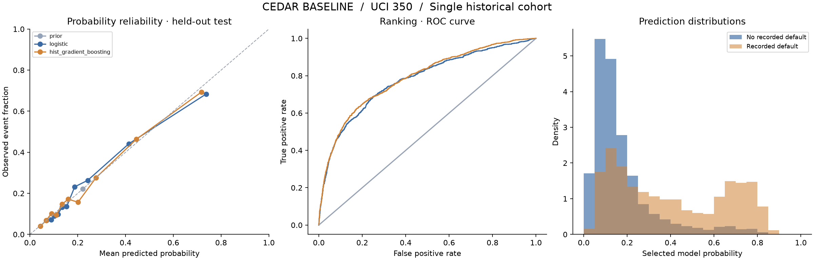

# Cedar baseline — 실제 학습·평가 결과

**선택 모델: hist_gradient_boosting**  
버전: `cedar-v0-2e744ab0dfc7`  
실행: 2026-09-14T22:15:29.652247+00:00

## 무엇을 예측하나

UCI 350의 대만 신용카드 고객에 대해 과거 6개월 기록으로 **다음 달 미상환 여부(Y)**를 예측한다.
출력은 해당 사건의 확률 추정치이며 점수는 `확률 × 100`이다.
기존 Cedar의 농업·소액금융 대출 또는 12개월 부도 확률에 대한 검증은 아니다.
원본은 2005년의 한 코호트이며, 현대 고객·다른 국가·다른 상품에 대한 성능은 알 수 없다.

## 평가 결과

선택은 validation의 log loss로 고정한 뒤 test를 열었다. 낮은 log loss/Brier, 높은 ROC-AUC/AP가 좋다.
AP는 average precision이며 PR 곡선의 사다리꼴 면적과 다르다.

| 모델 | Log loss ↓ | Brier ↓ | ROC-AUC ↑ | AP ↑ |
|---|---:|---:|---:|---:|
| prior | 0.5286 | 0.1723 | 0.5000 | 0.2213 |
| logistic | 0.4328 | 0.1356 | 0.7773 | 0.5478 |
| logistic_sigmoid | 0.4327 | 0.1356 | 0.7773 | 0.5478 |
| hist_gradient_boosting **(선택)** | 0.4244 | 0.1332 | 0.7874 | 0.5614 |
| hist_gradient_boosting_sigmoid | 0.4244 | 0.1332 | 0.7874 | 0.5614 |

최종 평가 6,000건, 미상환 비율 22.13%.
선택 모델의 ROC-AUC 95% 구간: 0.771–0.802;
log loss 95% 구간: 0.407–0.440.
금융 프로필 그룹 단위 bootstrap 200회의 탐색적 구간으로, 미래·다른 시장의 불확실성을 포함하지 않는다.

## 실험을 재현하는 장치

- 학습/보정/선택/평가 분할을 `artifacts/splits.csv`에 보관.
- 금융 입력이 동일한 행을 같은 구간에 배정. 구간 간 금융 프로필 중복은 0.
- 전처리는 학습 구간에만 적합. sigmoid 보정은 별도 구간에서 적합.
- 후보와 선택 규칙은 `EXPERIMENT_PLAN.md`에 명시. 최종 평가 이후 재학습하지 않음.
- 데이터 원본 SHA-256, 코드 해시, 의존성 버전, 모델 해시를 manifest에 기록.
- 모델 API가 동일한 전처리·모델을 로드. 임의의 확률이나 기본 점수로 대체하지 않음.

## 이번 결과가 증명하지 않는 것

- 원본 Y의 상세 연체 일수 정의는 충분하지 않다. 30일/90일 연체라고 해석하지 않는다.
- 승인된 기존 카드 고객 데이터이므로 신규 신청자·거절 고객을 대표한다고 가정하지 않는다.
- 미래 시간 분할, 지역 분할, 소액금융기관 외부 검증을 하지 못했다.
- 개인별 위치가 없어 기후 정보를 임의로 결합하지 않았다. 기후 정보의 추가 효과는 미검증이다.
- 민감 속성을 입력에서 제외했어도 공정성이 검증된 것은 아니다.
- 특정 조치를 하면 위험이 줄어든다는 인과 효과나 자동 승인/거절 정책은 추정하지 않는다.
- API의 관측 범위 표시는 단순한 학습 범위 검사이며 통계적 신뢰구간이 아니다.

## 다음 실험

1. 실행 시점·지역·상환 결과가 함께 있는 대출 데이터 확보와 이용 조건 검토.
2. 실제 대출 상품에 맞는 사건/기간 정의, 당시 알 수 있었던 입력으로 시간 분할.
3. 동일 모델·동일 평가 구간에서 금융 정보만 사용한 버전과 기후 정보 추가 버전 비교.
4. 운영 중 입력 변화·오류·지연 확인, 정답이 도착하면 코호트별 calibration과 성능 재평가.

## 출처

Yeh, I. (2009). Default of Credit Card Clients. UCI Machine Learning Repository. CC BY 4.0.
https://doi.org/10.24432/C55S3H  
https://archive.ics.uci.edu/dataset/350/default+of+credit+card+clients
