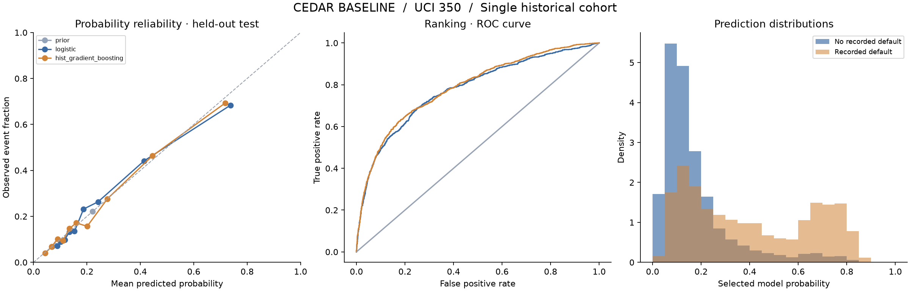

# Cedar — Credit Risk Modeling & Scoring API

**A reproducible probability model, evaluated offline and served through the same validated FastAPI interface.**

Independent follow-up to the Cedar team hackathon prototype by **Heedong (Daniel) Jang**. The follow-up uses public UCI data to replace unsupported prototype claims with a traceable baseline. It is not a credit model validated for microfinance or climate-related lending.

## What is implemented

- Separate training, probability-calibration, model-selection and test partitions.
- Grouped splitting to keep identical financial profiles out of different partitions.
- Prior, logistic and histogram gradient boosting models, including sigmoid calibration candidates.
- Model selection by validation log loss before evaluating test data.
- Saved model, data/code hashes, evaluation metrics, model card and reproducibility tests.
- A FastAPI service with strict inputs, model metadata, health checks and aggregate request metrics.



The recorded selected model is histogram gradient boosting. Its held-out test ROC-AUC is **0.7874**, average precision **0.5614**, log loss **0.4244**, and Brier score **0.1332** on 6,000 records. These are historical benchmark results, not production performance. See [metrics](artifacts/metrics.json), [model card](MODEL_CARD.md), and [original validation record](VERIFICATION.md).

## Run locally

Python 3.12, from this repository's root:

```bash
python3.12 -m venv .venv
source .venv/bin/activate
pip install -r requirements.lock.txt
OMP_NUM_THREADS=2 OPENBLAS_NUM_THREADS=2 python -m pytest -q
OMP_NUM_THREADS=2 OPENBLAS_NUM_THREADS=2 uvicorn cedar.api:app --host 127.0.0.1 --port 8010
```

Open `http://127.0.0.1:8010/docs`, or:

```bash
curl http://127.0.0.1:8010/health
curl -X POST http://127.0.0.1:8010/predict \
  -H 'Content-Type: application/json' \
  --data-binary @examples/request.json
```

The bundled request is a fictitious financial history. Six-month arrays run from most recent to oldest; monetary values are in New Taiwan dollars. The output score is `100 × predicted probability`, not a conventional credit score. Missing or invalid inputs are rejected; unavailable models do not produce fabricated fallback scores.

`/model` returns model information. `/metrics` returns aggregate in-process counters, latency and mean probability; it does not store individual request inputs and resets when the process restarts.

Only load the trusted bundled model or an artifact you trained yourself. Joblib is executable serialization; a matching hash detects modification but does not authenticate an unknown publisher.

## Reproduce training

```bash
python -m cedar.data --output data/uci350.csv
OMP_NUM_THREADS=2 OPENBLAS_NUM_THREADS=2 python -m cedar.train \
  --data data/uci350.csv --output runs/reproduction
```

The downloader verifies the expected source hash. A new output directory prevents accidental overwriting of the recorded experiment. Serve a new run with `CEDAR_ARTIFACT_DIR=runs/reproduction/artifacts`.

## Container

```bash
docker build -t cedar-credit-risk:local .
docker run --rm -p 127.0.0.1:8010:8000 cedar-credit-risk:local
```

The container runs as a non-root user. This is a local service example; public production deployment would require its own access controls and operational validation.

## Data and scope

Source: Yeh, I. (2009), [Default of Credit Card Clients, UCI](https://doi.org/10.24432/C55S3H), licensed [CC BY 4.0](https://creativecommons.org/licenses/by/4.0/). The original dataset has 30,000 Taiwan credit-card clients and 23 features. This implementation selects 19 financial inputs and predicts the original next-month default label. Demographic attributes are not model inputs; that alone does not establish fairness.

The cohort is historical (2005). There is no external microfinance validation, climate-feature benefit, future-time validation, causal intervention effect, or realized lending return claim. Split IDs and profile hashes identify rows of the cited public dataset; the original financial-record CSV is downloaded separately.

## Project context

Cedar's original hackathon application was team work, with Daniel's documented role in DevOps and integration. This repository is the later independent modeling/API baseline, developed with AI-assisted tooling. It should not be described as the team's original production credit model.

[Korean setup and study guide](README.ko.md) · [Publication checks](PUBLICATION_VALIDATION.md) · [Portfolio](https://hdjang.com/projects/cedar/)
